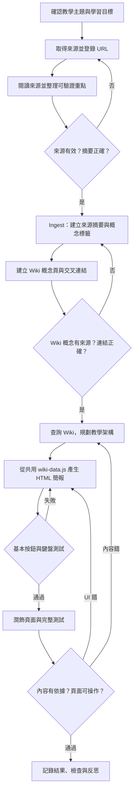

# RAG LLM Wiki：Workflow / Graph 設計

## 1. 先討論，後生成

先確定受眾是初學者，教學目標是理解「RAG 的定義、建庫、問答、風險與檢查」；確認要引用 5 份可信的公開來源。再以 LLM 協助產生 5 張來源卡、10 個可連結的概念頁，以及教學 HTML 簡報。**沒有直接把未檢查的原文送進簡報。**

## 2. 流程圖

## 3. 重複執行的節點

- **資料迴圈**：若摘要與原始資料有衝突，返回資料閱讀、修正摘要。
- **Wiki 迴圈**：若概念缺少來源 ID 或關聯概念不存在，重新檢查 ingest 及概念交叉連結。
- **簡報迴圈**：若簡報文字與 Wiki 不符，先查 Wiki 的來源映射；若是版面或互動錯誤，修正 HTML / CSS / JS 後重新測試。

## 4. 為什麼把檢查往前移？

一開始預想的簡單流程是「取得資料 → Wiki → 簡報 → 檢查」。問題是等簡報完成才發現來源不清楚，就要修改多個頁面。因此改為「**來源摘要檢查** → Wiki → **來源映射檢查** → 簡報 → UI 測試」，把最容易傳遞到下游的錯誤先排除。

## 5. Wiki 和簡報共用資料

`wiki-data.js` 包含來源 S1–S5 及概念頁。Wiki 網頁和簡報都讀取同一個資料檔；簡報每一頁顯示來源編號並連回對應 Wiki 概念頁，降低兩份文件互相矛盾的風險。

## 6. 技術邊界（誠實標註）

這個專案展示的是**LLM 輔助來源摘要、知識組織與產出靜態 Wiki**。五份來源均已整理為原創摘要，但沒有呼叫某款獨立 LLM Wiki 軟體的 `wiki_ingest` API，也沒有串接線上 LLM 即時對答。因此作業中的「ingest」是可檢查的知識整理流程，不能宣稱已完成某個外部工具的自動 ingest 工作。如果課堂指定特定軟體，應將 5 個 `source-notes/*.md` 再匯入該軟體並截圖紀錄。

## 7. 實際執行後的調整

第一次測試發現：按下「下一頁」後再按鍵盤右箭頭，因為按鈕取得焦點而未翻頁。修正 `slides.js` 快捷鍵事件條件後，重測已通過。因此除了來源檢查，我也把「HTML 基本互動測試」提前到美化版面之前，避免完成所有畫面才發現導航錯誤。詳見 `check-log.md`。
